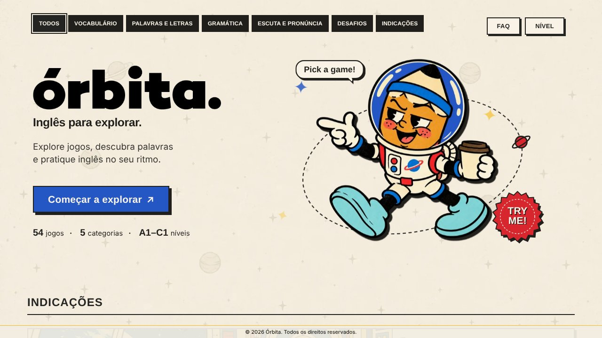

# órbita.

**Inglês para explorar.** Mais de 70 jogos no navegador, além de exercícios, leitura, escuta e escrita, para praticar inglês do A1 ao C2, sem cadastro: é só abrir e jogar.

👉 **[Jogar agora](https://exploreorbita.com.br)**



## O que é

O Órbita é uma coleção de jogos e atividades curtas para treinar vocabulário, gramática, escuta, leitura, escrita e pronúncia em inglês. Cada jogo se ajusta ao nível escolhido, e as instruções ficam em português para que o foco seja o inglês.

## Destaques

- **Mais de 70 jogos** em 8 categorias, de puzzles de palavras a jogos de lógica com imagens
- **Níveis do A1 ao C2**, ajustáveis a qualquer momento pelo botão *Nível*
- **Escape Room**: casos em lugares diferentes, com o texto em 4 níveis
- **Jogos de lógica e mistério**, como Caça ao ladrão, Grade de lógica e Quem está mentindo?
- **Jogos com imagens**, como Quem é quem?, Vestuário e Ligue os adjetivos
- **Exercícios, Leitura, Escuta e Escrita** além dos jogos
- **Áudio** nos jogos de escuta e pronúncia e nas histórias
- **Favoritos** marcados com estrela e **Progresso** com conquistas
- **Desafio do dia**, que sugere um jogo novo a cada dia
- **Funciona no celular, no tablet e no computador**

## Jogos

### 🔤 Puzzles de palavras
Palavra do dia (Wordle) · Tabuleiro de palavras (Scrabble) · Caça-palavras · Palavras cruzadas · Anagrama · Alquimia de palavras · Cadeia de palavras · Escada de palavras · Sem vogais · Palavra escondida · Stop · Forca · Frase cifrada

### 🕵️ Lógica e mistério
Escape room · Fuga · Quem sou eu? · Charada de emojis · Intruso · Duas verdades e uma mentira · Memória · Palavra-ponte · Conexões · Grade de lógica · Quem é quem? (pistas) · Quem está mentindo? · Agenda impossível · Animal misterioso · Caça ao ladrão

### 📚 Vocabulário
Vocabulário por tema · Instrutor de vocabulário · Ligue os pares · Descreva sem dizer · Escala de intensidade · Família de palavras · Cartas de categoria · Expressões idiomáticas · Sinônimos e antônimos · Tradução relâmpago · Verdadeiro ou falso

### 🖼️ Jogos com imagens
Quem é quem? · Vestuário · Qual é a imagem? · Ligue os adjetivos · Body Lab · Creature Lab · Animal Connections

### ✏️ Gramática
Detetive de erros · Ordem dos adjetivos · Comparativos e superlativos · Artigo certo · Preposição certa · Corretor de pontuação · Pergunta certa · Contável ou incontável · Verbos no passado · Palavras confusas · Metade da frase · Combina com quê? · Frase maluca · Construa a história

### 🎧 Escuta e pronúncia
Ship ou sheep? · Ditado relâmpago · Pegadinha de som · Ouça e acerte · Rima certa · Qual é a frase? · Caça aos erros · Soletre

### 🛒 Inglês da vida real
Monte o pedido · Compras e preços · Faça a mala · Resolva o problema

### 🏆 Arena
Contra o relógio · Sobrevivência · Chefão · Trilha · Roleta · Trivia em inglês

## Como rodar no seu computador

O site é estático: HTML, CSS e JavaScript, sem instalação. Como os jogos carregam arquivos de dados da pasta `data/`, abra-o por um servidor local (abrir o `index.html` direto no navegador pode bloquear esses arquivos).

1. Baixe o repositório (**Code → Download ZIP**) e descompacte.
2. Na pasta, rode `python3 -m http.server 8000` e abra `http://localhost:8000`.

> Os jogos de áudio dependem das vozes em inglês instaladas no seu sistema. Chrome e Edge costumam ter as melhores.

## Estrutura

```
index.html        a página inicial e o código principal
js/               código dos jogos, exercícios, leitura, escuta e escrita
css/              estilos
data/             o conteúdo dos jogos (veja abaixo)
audio/            áudios das histórias
img/              cenários, personagens e folhas de imagens dos jogos
objs/             ícones dos jogos
covers/           capas dos jogos
share/            imagens de compartilhamento
vid/              vídeos
```

## Onde editar o conteúdo

O texto dos jogos fica fora do código, na pasta `data/`:

- `data/*.json`: Caça ao ladrão (`chase`), Ligue os adjetivos (`adjmatch`), Quem é quem e Vestuário (`wq`), Contável ou incontável, Família de palavras, Descreva sem dizer, Escala de intensidade, Verbos no passado, Comparativos e superlativos, Monte o pedido, Resolva o problema e Faça a mala.
- `data/listas.js`: palavra do dia, adjetivos, temas e dicas de escrita, cenários de conversa, pronúncia e diário.
- `data/jogos.js`: o conteúdo dos jogos mais antigos (Detetive de erros, Trivia, Quem sou eu?, Palavras e outros).

Para corrigir uma frase ou uma pista, edite o arquivo e envie ao repositório. Mantenha as aspas e as vírgulas como estão.

## Seus dados

Não existe conta nem servidor. Favoritos, nível escolhido e progresso ficam salvos apenas no navegador de quem joga (localStorage). Limpar os dados do navegador apaga esse histórico.

---

© 2026 Órbita. Todos os direitos reservados.
